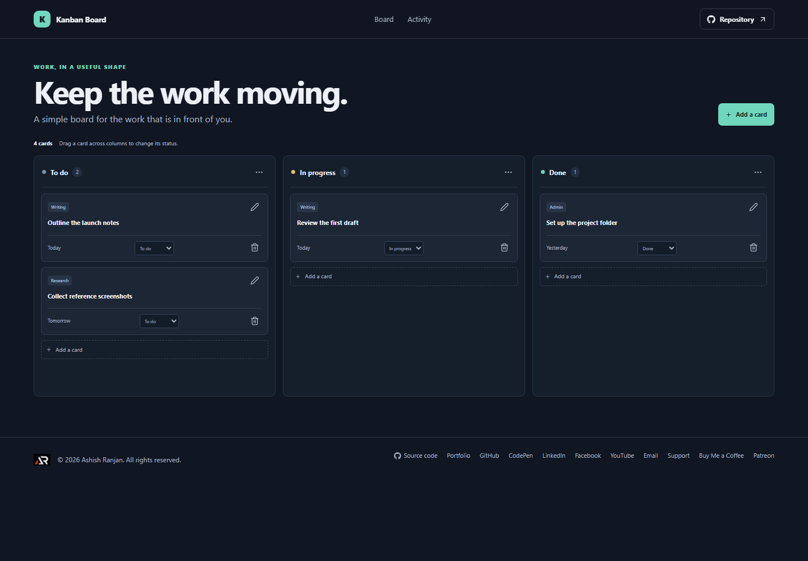

# Kanban Board

Kanban Board gives small projects a clear path from To do, through In progress, to Done.

## Interface

The board has three task columns with counts, per-column menus, task cards, and a board-wide add action.

## Features and use

Add cards to a chosen column, then edit their title or label. Drag cards between columns or use the status selector. Each column menu can add a card to that column, filter the board to that column, or restore the full board. Delete cards through the confirmation dialog.

## Data and limits

Cards and their column assignments are saved in localStorage for this browser. The board does not sync or support multiple users.

## Run locally

Use Node.js and npm, then run these commands from the project folder:

```sh
npm install
npm run dev
```

The app is built with React and Vite. Check the source and production build with:

```sh
npm run lint
npm run build
```

## Deployment

The public app is published with GitHub Pages at [https://a2rp.github.io/kanban-board/](https://a2rp.github.io/kanban-board/). To build and publish the current version, run:

```sh
npm run deploy
```

## Future improvements

Ideas that are not implemented yet:

- Custom columns, due-date reminders, and shared team boards.

## Links

- Portfolio: [https://www.ashishranjan.net](https://www.ashishranjan.net)
- GitHub: [https://github.com/a2rp](https://github.com/a2rp)
- CodePen: [https://codepen.io/ash1198](https://codepen.io/ash1198)
- LinkedIn: [https://www.linkedin.com/in/aashishranjan](https://www.linkedin.com/in/aashishranjan)
- Facebook: [https://www.facebook.com/theash.ashish/](https://www.facebook.com/theash.ashish/)
- YouTube: [https://www.youtube.com/@ashishranjan-ashz?sub_confirmation=1](https://www.youtube.com/@ashishranjan-ashz?sub_confirmation=1)
- Email: [mailto:ash.ranjan09@gmail.com](mailto:ash.ranjan09@gmail.com)

## Support

- Support: [https://a2rp-donation-page.netlify.app/](https://a2rp-donation-page.netlify.app/)
- Buy Me a Coffee: [https://buymeacoffee.com/ashishranjan](https://buymeacoffee.com/ashishranjan)
- Patreon: [https://www.patreon.com/ashishranjan](https://www.patreon.com/ashishranjan)